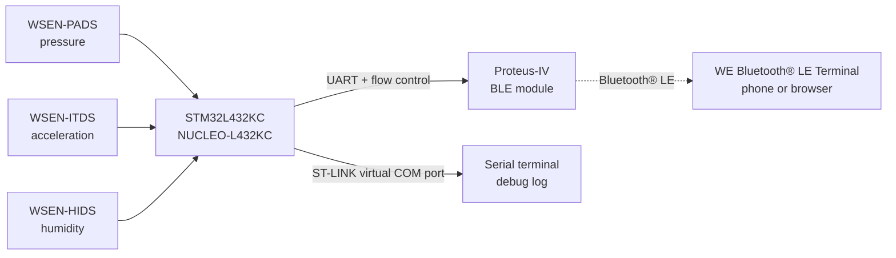

# Sensor data over Bluetooth® LE

Read Würth Elektronik sensors on an STM32, send the readings over Bluetooth® LE with the **Proteus-IV** radio module, and watch them live on your phone or in your browser.

This project is a working starting point. It runs out of the box, and it is small enough to read in an afternoon and bend into something new.




This repository is the starting point for the developers who intend to build a Bluetooth enabled end-device. You can create a Bluetooth® LE link between your hardware and a smart device.

The base example only reads three sensors and prints values. Your job is to turn it into an application that makes someone say "that is clever". Jump to [Ideas to get you started](#ideas-to-get-you-started) if you want inspiration.


## Table of contents

1. [What you need](#what-you-need)
2. [Quick start](#quick-start)
3. [Wiring](#wiring)
4. [What you should see](#what-you-should-see)
5. [How it works](#how-it-works)
6. [Project structure](#project-structure)
7. [Make it yours](#make-it-yours)
8. [Ideas to get you started](#ideas-to-get-you-started)
9. [Troubleshooting](#troubleshooting)
10. [Resources](#resources)
11. [License](#license)

---

## What you need

### Hardware

| Part | Role |
| --- | --- |
| **NUCLEO-L432KC** (STM32L432KC) | Host MCU, also provides the ST-LINK programmer and a virtual COM port |
| **[Proteus-IV](https://www.we-online.com/en/components/products/PROTEUS-IV)** Bluetooth® LE EV kit (2621129024001)  | Radio. Talks to the STM32 over UART |
| **[WSEN-PADS](https://www.we-online.com/en/components/products/WSEN-PADS)** EV-board (2511223013391) | Absolute pressure and temperature sensor (I²C) |
| **[WSEN-ITDS](https://www.we-online.com/en/components/products/WSEN-ITDS)** (2533203301691) | 3-axis accelerometer (I²C) |
| **[WSEN-HIDS](https://www.we-online.com/en/components/products/WSEN-HIDS)** (2525020210092)| Humidity and temperature sensor (I²C) |
| Jumper wires, USB cable (micro-USB for the Nucleo) | Wiring and power |

<!-- TODO (maintainer): replace this table with the exact kit contents and order codes, and add a photo of the assembled setup. -->

You also need a **smartphone** (Android or iOS) or a computer with a **Chromium-based browser** (Chrome or Edge) for the Bluetooth® LE side.

### Software

| Tool | Why |
| --- | --- |
| [STM32CubeIDE](https://www.st.com/en/development-tools/stm32cubeide.html) | Build and flash the firmware |
| Any serial terminal (PuTTY, Tera Term, minicom, the CubeIDE console) | Read the debug log |
| [WE Bluetooth® LE Terminal](https://wurthelektronik.github.io/WE-Bluetooth-LE-Terminal/) | Receive the sensor data. Web app, plus Android and iOS apps in the app stores |

The project was created with STM32CubeMX 6.14.0 and the STM32Cube FW_L4 V1.18.2 package. A recent STM32CubeIDE will open it without trouble.

---

## Quick start

You can have live sensor data on your phone in about 15 minutes.

1. **Clone this repository**
   ```bash
   git clone <this repository URL>
   ```

2. **Import it into STM32CubeIDE**
   `File > Open Projects from File System...`, select the cloned folder, and finish the import. The project name is `ProteusIV_Sensor_Config`.

3. **Wire everything up** as shown in [Wiring](#wiring). Double check the I²C and UART pins before you power on.

4. **Build** the project (hammer icon). The required compiler defines are already set in the project: `STM32L432xx`, `USE_HAL_DRIVER`, `USE_FULL_LL_DRIVER`, `WE_USE_FLOAT`, `WE_APP_PRINT_ENABLED`, `WE_UART_DMA` and `WE_DEBUG_PRINT_LEVEL=2`.

5. **Flash** the NUCLEO-L432KC (Run or Debug button).

6. **Open the debug log.** The Nucleo shows up as a virtual COM port. Open it at **115200 baud, 8N1**. Give the board about 5 seconds after reset, the firmware waits on purpose at startup.

7. **Open the WE Bluetooth® LE Terminal** on your phone or at [wurthelektronik.github.io/WE-Bluetooth-LE-Terminal](https://wurthelektronik.github.io/WE-Bluetooth-LE-Terminal/).

8. **Scan, pick your module type, connect.** Select **Proteus-IV** as the module type, scan, and choose your device. Accept the pairing request if your phone shows one.

9. **Watch the data arrive.** Once the link opens, the firmware sends a new set of readings roughly every 1.5 seconds.

Congratulations! You have successfully created a Bluetooth® LE connected device.

If something does not work, see [Troubleshooting](#troubleshooting).

---

## Wiring

Everything uses the pins already configured in the `.ioc` file, so you do not need to change anything in CubeMX.

> **Important:** Do **not** configure **PA5** or **PA6** as GPIO outputs. This can interfere with the I²C bus and break sensor communication.

### Sensors (shared I²C bus)

All three sensors connect to the same two lines.

| STM32 pin | Function | Connect to |
| --- | --- | --- |
| PB6 | I2C1 SCL | SCL of PADS, ITDS and HIDS |
| PB7 | I2C1 SDA | SDA of PADS, ITDS and HIDS |
| 3V3 and GND | Power | VCC and GND of all three sensor boards |

### Proteus-IV

| STM32 pin | Function | Proteus-IV pin |
| --- | --- | --- |
| PA9 | USART1 TX | UART RX |
| PA10 | USART1 RX | UART TX |
| PA12 | USART1 RTS | UART CTS |
| PA11 | USART1 CTS | UART RTS |
| PA4 | GPIO output | Reset |
| PB0 | GPIO output | Mode 0 |
| PB1 | GPIO output | Mode 1 |
| PA3 | GPIO output | UART enable |
| PA7 | GPIO input | LED 1 (link status) |
| 3V3 and GND | Power | VCC and GND |

TX goes to RX and RTS goes to CTS. Hardware flow control is enabled, so please do not skip the RTS and CTS lines.

```text
  _____________________                ____________________
 |         PADS        |              |       STM32        |
 | SCL ----------------|<-------------|                    |
 | SDA ----------------|<------------>| I2C1 SCL (PB6)     |
 |_____________________|              | I2C1 SDA (PB7)     |              ______________________
                                      |                    |             |      Proteus-IV      |
  _____________________               | Reset (PA4)        |------------>| Reset                |
 |        ITDS         |              | Mode_0 (PB0)       |------------>| Mode0                |
 | SCL ----------------|<-------------| Mode_1 (PB1)       |------------>| Mode1                |
 | SDA ----------------|<------------>| LED_1 (PA7)        |<------------| LED_1                |
 |_____________________|              | UART_ENABLE (PA3)  |------------>| UART_ENABLE          |
                                      | USART1 TX (PA9)    |------------>| UART RX              |
  _____________________               | USART1 RX (PA10)   |<------------| UART TX              |
 |        HIDS         |              | USART1 RTS (PA12)  |------------>| UART CTS             |
 | SCL ----------------|<-------------| USART1 CTS (PA11)  |<------------| UART RTS             |
 | SDA ----------------|<------------>|                    |             |______________________|
 |_____________________|              |____________________|
```

The debug log uses USART2, which is already routed to the ST-LINK virtual COM port on the Nucleo. No extra wiring needed.

---

## What you should see

### In the serial log

Roughly in this order after reset:

```text
Wuerth Elektronik eiSos Wireless Connectivity SDK version x.y.z
Peripheral_CommandMode_Temperature_Example started
OK    ProteusIV: Set SecFlags
I2C device found at 0x..
I2C device found at 0x..
I2C device found at 0x..
HIDS Initialized
Waiting for link to open
```

Three I²C devices in the scan means all three sensors are wired correctly. After you connect from the app you will see lines such as:

```text
Conn_ID 0: Connected to device (...)
Conn_ID 0: Max payload updated to ... bytes
Conn_ID 0: Link opened
HIDS:
 Temperature: 23.45 degC
 Humidity: 41.3 %
```

### In the app

Three messages per cycle, one per sensor, in plain text:

```text
HIDS:
 Temperature: 23.45 degC
 Humidity: 41.3 %

ITDS:
 X: 12 mg
 Y: -4 mg
 Z: 998 mg

PADS:
 Temperature: 23.80 degC
 Pressure: 1013.25 hPa
```

(Your numbers will differ, of course.)

A quick sanity check: with the board lying flat, the Z axis of the accelerometer should read close to 1000 mg. Tilt the board and watch the axes change. Breathe on the humidity sensor and watch the humidity jump.

---

## How it works

The firmware is a single readable loop in `Core/Src/main.c`.

1. **Platform start.** `WE_Platform_Init()` sets up the clock and waits a few seconds so the flasher does not start old code by accident.
2. **Radio start.** The Proteus-IV is initialised in **command mode** at 115200 baud with RTS/CTS flow control. A set of callbacks is registered for connect, disconnect, received data, security events and so on.
3. **Security.** The module is configured for encrypted links without user input (security flag `NO_IO_MINPERIPHERAL_LEVEL_L2`). Your phone may ask you to pair.
4. **Sensor start.** Each sensor has its own small init function with settings you can change (see below).
5. **Main loop.** For every open Bluetooth® LE connection, the firmware reads the three sensors, formats the values as text and sends them with `ProteusIV_Transmit()`. If no link is open, it prints "Waiting for link to open" and tries again.

The data goes out as readable ASCII text on purpose. That means the stock WE Bluetooth® LE Terminal can show it without any custom app. When you are ready for something more serious, replace the text with a compact binary or JSON format and build your own app (see [Make it yours](#make-it-yours)).

### Default sensor settings

| Sensor | Configuration in the example |
| --- | --- |
| WSEN-HIDS | Low precision measurement mode |
| WSEN-ITDS | Normal mode, 200 Hz output data rate, ±16 g full scale, block data update, filter bandwidth ODR/2 |
| WSEN-PADS | Low-noise mode, 50 Hz output data rate, extra low-pass filter (ODR/20), block data update |

Note that the example reads the sensors only about every 1.5 seconds, even though the ITDS and PADS can sample much faster.

---

## Project structure

```text
.
├── Core/
│   ├── Inc/                    STM32 headers (main.h, HAL config, interrupts)
│   └── Src/main.c              The application: init, main loop, Proteus-IV callbacks
├── Drivers/                    STM32 HAL, LL and CMSIS drivers
├── Sensors-SDK_STM32/
│   ├── SensorsSDK/             WSEN-PADS, WSEN-ITDS and WSEN-HIDS drivers
│   └── platform/               I²C and SPI glue code for the sensor drivers
├── WCON_SDK/
│   ├── WCON_Drivers/ProteusIV/ Proteus-IV driver (command protocol over UART)
│   ├── WCON_Drivers/global/    Shared driver types and helpers
│   ├── WCON_Drivers/utils/     Base64 and JSON helpers
│   └── global/                 STM32 platform code: GPIO, delays, debug print over UART
├── ProteusIV_Sensor_Config.ioc STM32CubeMX configuration (pins, clocks, peripherals)
└── README.md
```

---

## Make it yours

Here is where to look for the things you will most likely want to change.

| I want to... | Look here |
| --- | --- |
| Change how often data is sent | The `WE_Delay(1500)` inside the main loop in `main.c` |
| Change the message format | The `sprintf(...)` calls in `Peripheral_CommandMode_Temperature_Example()` |
| Tune sensor behaviour (sample rate, range, filters) | `HIDS_Device_Init()`, `ITDS_Device_Init()`, `PADS_Device_Init()` |
| React to data sent from the phone | `RxCallback()`. Everything you type in the app arrives here |
| Rename the Bluetooth device | `ProteusIV_SetDeviceName()` |
| Change advertising interval or TX power | `ProteusIV_SetAdvertisingInterval()` and the TX power setting of the driver |
| Change security and pairing behaviour | `ProteusIV_SetSecFlags()` in `ProteusIV_Device_Init()` |
| Add another sensor | Add its driver from the Sensors SDK, give it an init function and add a read and send block to the loop |
| Print more or less debug output | `WE_DEBUG_PRINT_LEVEL` and `WE_APP_PRINT_ENABLED` in the project defines |

### Sending commands from the phone

Whatever you type in the app arrives in `RxCallback()` as a byte buffer. A few lines of parsing there turns the app into a remote control: change the sampling rate, switch an output, request a single measurement and so on.

### Adding a second MCU peripheral

The project already uses I²C1, USART1 for the radio and USART2 for the log. Free pins on the Nucleo are yours to use. Just remember the PA5 and PA6 warning above.

---

## Ideas to get you started

You are free to build anything. If you want a nudge:

- **Cold chain or package monitor.** Log temperature, humidity and shocks during shipping and read them out over BLE at the destination.
- **Fall and impact detection.** Use the accelerometer to detect free fall, taps or impacts and send an alert instead of a stream.
- **Floor and altitude tracker.** Pressure changes of a few pascals correspond to height changes of tens of centimetres. Build an indoor floor detector or a climbing log.
- **Indoor climate coach.** Combine humidity and temperature into a comfort index and nudge the user to ventilate.
- **Vibration and condition monitoring.** Sample the accelerometer fast, compute a simple RMS or FFT on the STM32 and report only the result.
- **Edge AI.** Train a tiny model for gesture or activity recognition from accelerometer data and run it on the STM32L4. Send the classification result instead of raw data, which also saves radio energy.
- **Your own app.** Replace the stock terminal with a custom mobile or web dashboard. The terminal app is open source and a good place to start.
- **Low power.** Put the MCU to sleep between measurements and see how long a coin cell can run it.


---

## Troubleshooting

**I do not see anything in the serial terminal.**
Check that you opened the right COM port at 115200 baud, and wait about 5 seconds after reset. Make sure the build defines `WE_APP_PRINT_ENABLED` and `WE_DEBUG_PRINT_LEVEL=2` are still set.

**The I²C scan finds no devices.**
Check SDA and SCL (PB7 and PB6), shared ground and 3.3 V supply. Make sure PA5 and PA6 are not configured as outputs. Check that the sensor boards have pull-up resistors on the bus, either on the sensor boards or from the Nucleo.

**The I²C scan finds fewer than three devices.**
One sensor is not powered or is wired incorrectly. Disconnect the others and test them one at a time.

**"ProteusIV: Initialisation error".**
The MCU cannot talk to the module. Check TX and RX are crossed, RTS and CTS are crossed, the reset and mode pins are connected, and the module is powered.

**The module does not show up in the scan.**
Restart the app scan, make sure the module is powered and not already connected to another device, and move closer. If you use the web app, use a Chromium-based browser with Bluetooth enabled.

**It connects, but I get no data.**
Data is only sent after the link is open. Check the serial log for the "Link opened" line. If it never appears, disconnect, reset the board and connect again.

**Messages look cut off.**
Each message is limited to the maximum payload negotiated for the connection (see the "Max payload updated" log line). A short MTU can shorten long text blocks. Keep messages compact, or split them into several smaller messages.

**The values look wrong.**
Check the units in the format strings. The ITDS output is in milli-g, the HIDS values are scaled in thousandths, and the PADS pressure is in hPa. Also remember that the example uses low precision mode for HIDS.

**The build fails with missing include paths.**
Make sure you imported the project folder through `Open Projects from File System` so CubeIDE picks up the stored include paths, and that the `Drivers` folder is present.

---

## Resources

- **WE Bluetooth® LE Terminal** (the app used here): [web app](https://wurthelektronik.github.io/WE-Bluetooth-LE-Terminal/) and [source on GitHub](https://github.com/WurthElektronik/WE-Bluetooth-LE-Terminal)
- **Wireless Connectivity SDK** (drivers and examples for Würth Elektronik radio modules): [github.com/WurthElektronik/WirelessConnectivity-SDK](https://github.com/WurthElektronik/WirelessConnectivity-SDK)
- **Sensors SDK for STM32** (drivers for the WSEN sensor family): [github.com/WurthElektronik/Sensors-SDK_STM32](https://github.com/WurthElektronik/Sensors-SDK_STM32)
- **Würth Elektronik wireless connectivity solutions**: [we-online.com/wco](https://www.we-online.com/en/components/products/ac/wco)
- **Würth Elektronik sensors**: [we-online.com/sensors](https://www.we-online.com/sensors)
- **STM32CubeIDE**: [st.com/stm32cubeide](https://www.st.com/en/development-tools/stm32cubeide.html)

<!-- TODO (maintainer): add direct links to Proteus-IV product page and manual, WSEN-PADS / ITDS / HIDS product pages, and the challenge forum thread. -->

---
